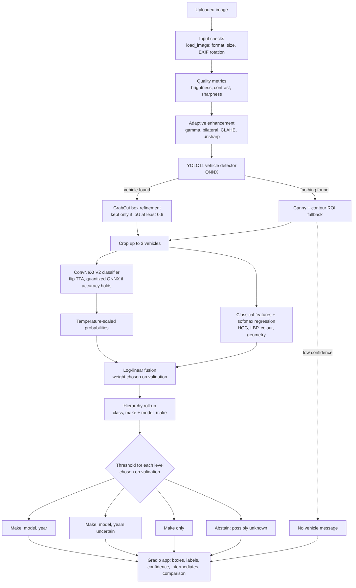

# Design Document: P5 Fine-Grained Vehicle Recognition

## 1. Problem
Given a real-world photo, locate the main vehicle (or, in a busy scene, every vehicle) and report make, model, year and confidence across 196 Stanford Cars classes, including under poor lighting, occlusion, low resolution and unusual angles.

## 2. Goals and non-goals
Goals: accurate end-to-end recognition; measurable comparison of classical, deep and hybrid approaches; reliable behaviour on unexpected uploads; responses within about 10 seconds on a CPU.
Non-goals, as the brief allows: number-plate recognition, tracking and traffic events.

## 3. Data
16,185 images: 8,144 training and 8,041 test, one annotated box each. 10% of training images, stratified by class, form a validation set (`data.py`). Every choice uses validation data. Test images are used once, for the final report.

## 4. Architecture

The code follows the diagram: `pipeline.py` runs the flow, `classical.py` holds classical vision, `decision.py` holds calibration, fusion and decisions, `metrics.py`, `corruptions.py` and `evaluation.py` hold evaluation, and `app.py` holds the UI.

## 5. Classical computer vision
| Requirement | Implementation | Why |
|---|---|---|
| Preprocessing, normalization | Quality metrics, adaptive gamma and CLAHE, bilateral filter, unsharp mask, classifier normalization | Fixes only measured problems, so good images stay unchanged |
| Edges, contours | Auto-threshold Canny, morphological closing, contour scoring | Provides a detector-free fallback region and the classical baseline |
| Colour, texture | HSV histogram; grid LBP histograms | Standard compact descriptors |
| Region of interest | Contour ROI; GrabCut box refinement | Removes background; refinement is rejected if it disagrees with the detector |
| Geometry | Aspect ratio, frame fraction, edge density, solidity, extent, Hu moments | Captures body proportions |

## 6. Deep learning
**Classifier:** ConvNeXt V2 Base at 384 px, fine-tuned with transfer learning from ImageNet-22k weights. Fine-grained differences (badges, lights, grilles) need higher resolution. A convolutional model also trains well on about 40 images per class. Training uses layer-wise learning rates, Mixup and CutMix, label smoothing, RandAugment, random erasing for occlusion, stochastic depth and EMA.

**Box jitter:** training crops are randomly perturbed, because the deployed classifier sees imperfect detector boxes rather than annotations.

**Detector:** YOLO11n, chosen for CPU speed. Stock COCO weights (car, bus, truck classes) and a one-class fine-tuned model are compared on validation, and the better one is used.

## 7. Hybrid integration
1. Adaptive classical enhancement before detection.
2. Detected regions drive classification. The pipeline accepts up to three detections, but the detector was trained with one annotated car per image, so it usually finds only the main car. For busy scenes the app switches to the stock COCO YOLO11n detector (score at least 0.5): it boxes every vehicle and names the four largest. This route was added after the evaluation and is not part of the reported results.
3. GrabCut refinement, and a contour fallback if the detector finds nothing. A fallback result is shown only at full-answer confidence.
4. Log-linear fusion: `log p = log p_deep + beta * log p_classical`. Beta is tuned on validation and may be 0.
5. Low-confidence handling: temperature scaling, then rolling probabilities up from class to make + model to make. The app reports the most specific level that clears its validation-derived threshold. Otherwise it abstains, although with the validated make threshold of 0.0 this never happens for a detected object (see section 13).

## 8. Optimization
Dynamic and static int8 quantization are tried in ONNX Runtime. The smallest model that loses no more than 0.5 validation top-1 points is deployed. Size, CPU latency and accuracy are reported. The deployed app needs no PyTorch.

## 9. Evaluation method
`07_evaluate.py` reports the brief's metrics: top-1 and top-5, IoU, mAP, size and time, robustness under seven corruptions at three severities, and calibration with threshold analysis. Accuracy is end-to-end, using predicted boxes. A ground-truth-box result appears only as a labelled upper bound.

## 10. Results
See `../eval_P5_T10.md` and `ABLATION_AND_FAILURES.md`. Every figure there is generated from `results/metrics.json`.

## 11. Bad-input handling
Tiny images, oversized images, phone rotation, images with no vehicle, busy scenes (every vehicle boxed, the four largest named) and internal errors produce a clear response. Files that are not images are rejected by the upload component with a general error.

## 12. Deployment
Gradio on CPU with ONNX Runtime, packaged with a Dockerfile; `deploy/` holds the Hugging Face Space configuration. The optional busy-scene detector (`detector_coco.onnx`) is loaded from `models_extra/` when present; without it the app runs in single-vehicle mode.

## 13. Limitations
A closed set of 196 classes, mostly up to 2012 and US-market. One annotated box per image. No viewpoint labels. The validated make-level threshold is 0.0, so the app never abstains on a detected object: an unfamiliar car, or a non-car object the detector picks up, gets a make-only answer marked as low confidence.

## 14. Ethics
Research demo only. It does not identify people and must not support surveillance or enforcement decisions. Dataset geography and age bias are stated in the app. Uploaded images are not saved by the app code.

## 15. Team contributions
Team members and their responsibilities are listed in the technical report (`docs/REPORT.md`, section 10).
